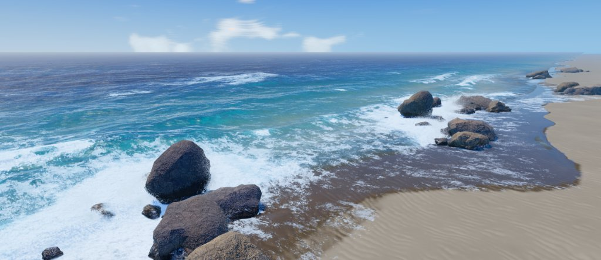
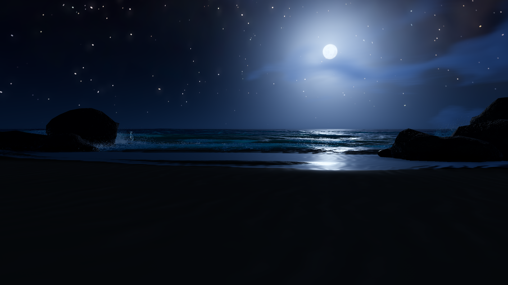
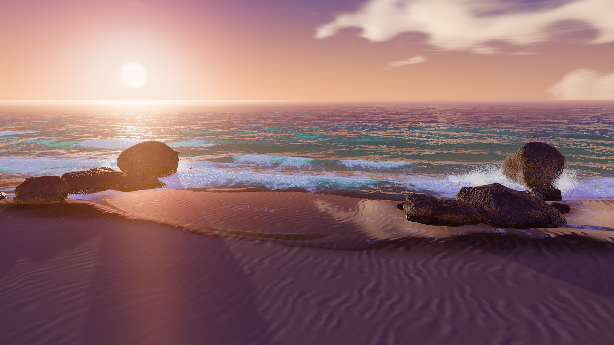
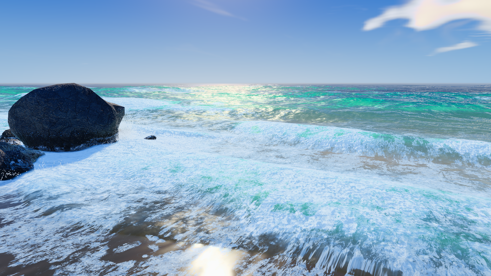
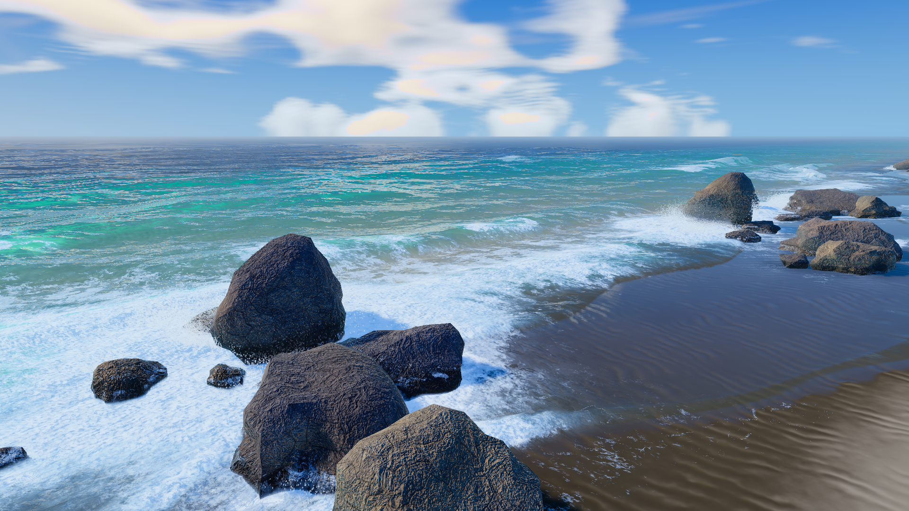
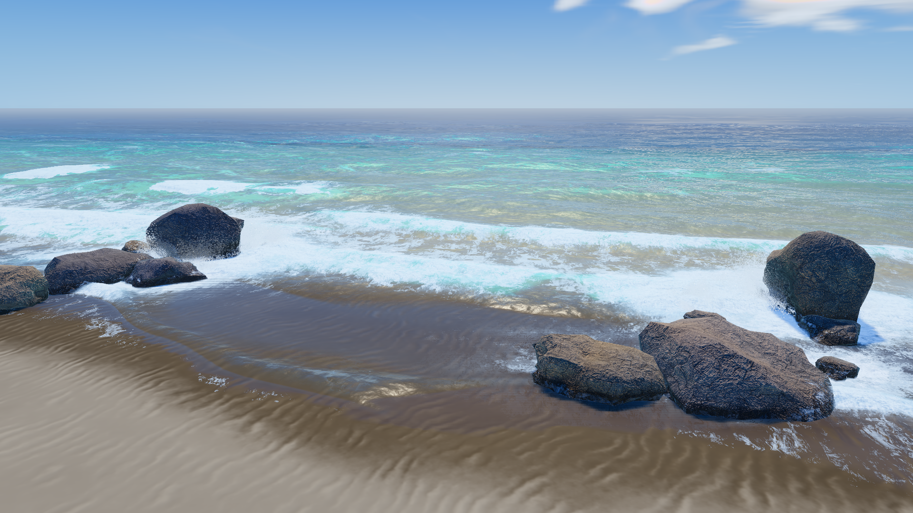
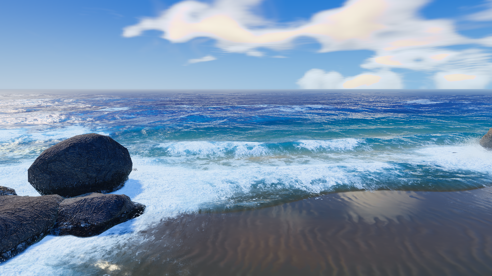
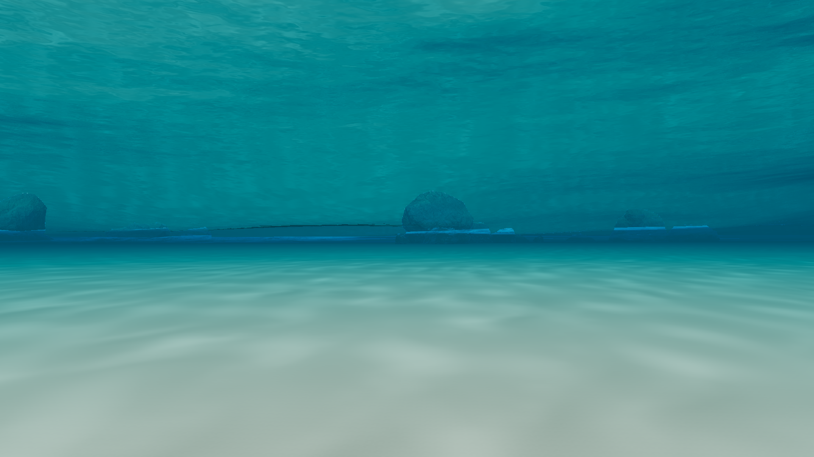
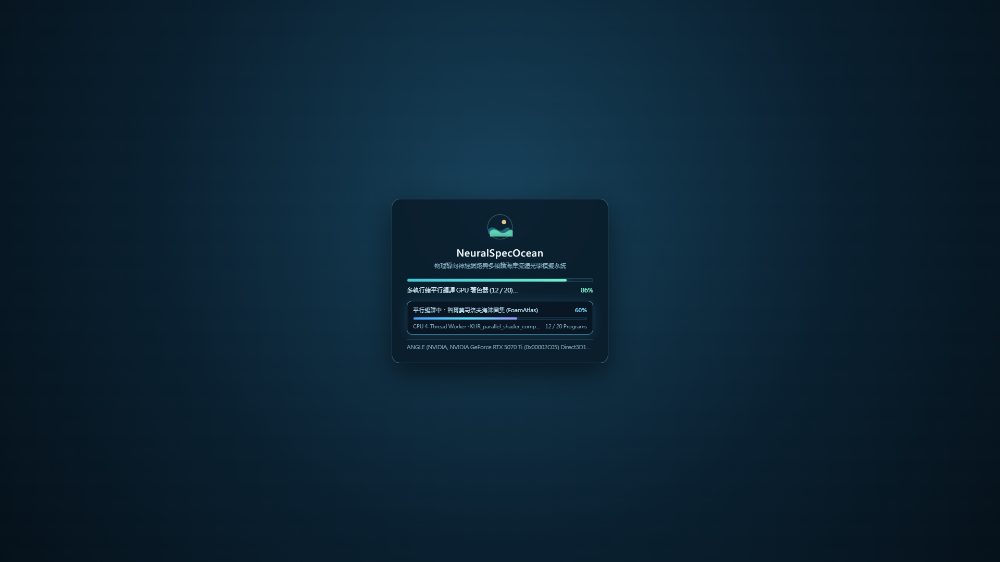
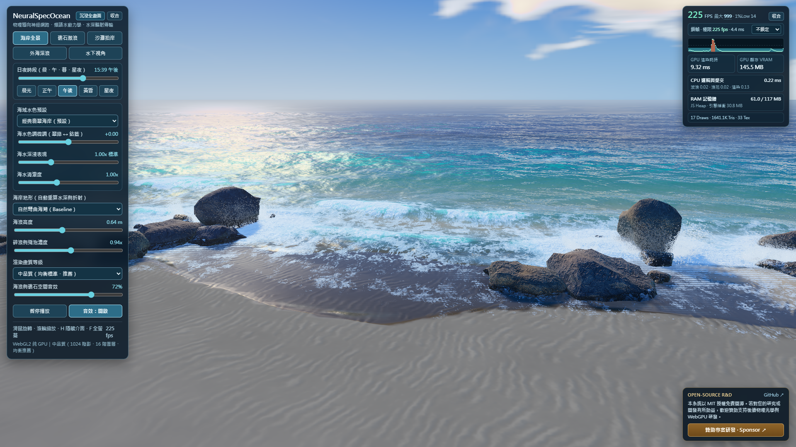

<div align="center">

# NeuralSpecOcean

**Physics-Informed Neural and Multi-Spectral Coastal Ocean Simulation in WebGL2**

[](https://bgbg108555.github.io/NeuralSpecOcean/)
[](https://github.com/bgbg108555/NeuralSpecOcean/releases)
[](./LICENSE)
[](https://bgbg108555.github.io/NeuralSpecOcean/)
[](https://x.com/ShengChoi)
[](https://portaly.cc/AlphaCore/support)

[**English**](./README.md) | [**繁體中文 (Traditional Chinese)**](./README.zh-TW.md) | [**Technical Whitepaper**](./TECHNICAL_WHITEPAPER.md) | [**Live Demo**](https://bgbg108555.github.io/NeuralSpecOcean/) | [**X Devlog (@ShengChoi)**](https://x.com/ShengChoi) | [**Sponsorship**](#sponsorship-and-research-support)

---



</div>

> [!IMPORTANT]
> **C++ MMORPG Engine R&D & Open-Source Sponsorship** — **NeuralSpecOcean** originated as an R&D coastal hydrodynamics, neural-operator, and marine-optics prototype for an **upcoming native C++ MMORPG** currently in active development. As this simulation pipeline is being ported and implemented natively in C++ for the game engine, we are releasing the complete WebGL2 prototype and mathematical whitepaper under the permissive [MIT License](./LICENSE) as a contribution to the graphics and game development community.  
> - **Follow C++ MMORPG & Engine Devlogs on X**: [**@ShengChoi (https://x.com/ShengChoi) →**](https://x.com/ShengChoi)  
> - **Sponsor Ongoing Open-Source R&D (International Credit Cards Supported)**: [**Support via Portaly →**](https://portaly.cc/AlphaCore/support)

---

## Abstract

**NeuralSpecOcean** is an open-source, real-time coastal ocean, atmospheric radiative transfer, and hydro-acoustic simulation framework implemented in pure **WebGL2** and multi-threaded **Web Workers**. Compiled into a single self-contained `2.14 MB` HTML artifact ([`index.html`](./index.html)) with zero external runtime dependencies, the system couples spectral physical oceanography, two-dimensional shallow-water partial differential equations (PDEs), marine bio-optics, and online-trained physics-informed neural networks (PINNs).

The nomenclature **NeuralSpecOcean** reflects the two mathematical foundations of the system:
1. **Physics-Informed Neural Operators (`Neural`)**: Three compact neural surrogates trained asynchronously in browser worker threads using $`W^{1,2}`$ Sobolev derivative matching, exact orthogonal weight initialization, power-iteration spectral normalization, and an analytical Clausius–Duhem Hilbert space convex projection enforcing the First and Second Laws of Thermodynamics.
2. **Multi-Domain Spectral Formulations (`Spec`)**: Tri-band Fast Fourier Transform (FFT) gravity–capillary wave spectra, wavelength-resolved Case-1/Case-2 marine bio-optical attenuation spectra, chromatic surface-Hessian seabed caustics, and Hinze-scale power-law bubble acoustic resonance spectra.

- **Interactive Browser Demonstration**: [https://bgbg108555.github.io/NeuralSpecOcean/](https://bgbg108555.github.io/NeuralSpecOcean/)
- **Standalone Offline Artifact**: Available under [GitHub Releases](https://github.com/bgbg108555/NeuralSpecOcean/releases) (`NeuralSpecOcean-v1.0.0-Standalone.html`)
- **Mathematical Formulations and Bibliography**: Detailed in [`TECHNICAL_WHITEPAPER.md`](./TECHNICAL_WHITEPAPER.md)


---

## Visual Results

All figures below are unedited real-time WebGL2 outputs rendered at `1920 x 1080` resolution.

| **Nocturnal Ephemeris and Gaia DR2 Astrometry** | **Chapman–Ozone Twilight Radiative Transfer** |
| :---: | :---: |
|  |  |
| *Localized lunar cloud rim scattering and 1-texel NMS starfield reconstruction* | *Neural spherical-shell Chappuis-band ozone absorption and wet-sand thin-film reflectance* |
| **Wave–Rock Impact and Dielectric Spray** | **Monotonic Alongshore Surf Transformation** |
|  |  |
| *Thermodynamically constrained impact PINN and 262,144 instanced dielectric droplets* | *Orientation-preserving coastal diffeomorphism ($`ds/du \ge 0.3403 \gt 0`$) over variable bathymetry* |
| **Shallow Carbonate Lagoon Bio-Optics** | **Deep Pelagic Beer–Lambert Attenuation** |
|  |  |
| *Low-chlorophyll shallow-water scattering and refracted seabed caustics* | *High-depth long-wavelength absorption and GGX microfacet sky reflectance* |
| **Submerged Snell's Window and Chromatic Caustics** | **Asynchronous Multi-Threaded Initialization** |
|  |  |
| *Total internal reflection ($`\theta_c \approx 48.56^\circ`$) and 3-wavelength Hessian caustics* | *Concurrent `Web Worker` PINN optimization and `KHR_parallel_shader_compile` pipeline* |

---

## Technical Architecture

Full partial differential equations, neural network topologies, and 28 peer-reviewed references are documented in [`TECHNICAL_WHITEPAPER.md`](./TECHNICAL_WHITEPAPER.md).

### 1. Tri-Band Spectral Wave Synthesis and Monotonic Coastal Geometry
Ocean surface elevation and horizontal Gerstner displacements are synthesized across three incommensurate spectral cascades ($`128^2`$ swell band at `240 m`, $`64^2`$ gravity band at `28 m`, and $`64^2`$ capillary–gravity chop band at `11.3 m`) governed by depth-dependent dispersion $`\omega(k, h) = \sqrt{(gk + (\sigma/\rho_w)k^3)\tanh(kh)}`$. Nearshore grid resolution is concentrated along the surf zone via a smooth diffeomorphism $`s(u) = u - 0.21\sin(\pi u)`$, whose strictly positive Jacobian ($`ds/du \ge 0.3403 \gt 0`$) prevents mesh folding and normal inversion.

### 2. Two-Dimensional GPU Nonlinear Shallow-Water Solver (`SwashRigGPU`)
Nearshore run-up, backwash, boulder flow deflection, porous sand infiltration, and persistent foam transport are integrated on a $`512 \times 256`$ half-precision (`RGBA16F`) ping-pong render target over pre-baked bathymetry and signed shoreline distance fields.

### 3. Embedded Physics-Informed Neural Networks (`Sobolev-PINNs`)
Three domain-specific neural networks are trained from random/orthogonal initialization inside parallel `Web Worker` threads during initialization, requiring zero external weight files:
- **Spherical-Shell Chapman–Ozone Transmittance Network** (`2 -> 8 SiLU -> 6 Sigmoid`, 78 parameters): Trained on low-discrepancy Sobol sequences with $`W^{1,2}`$ Sobolev gradient supervision to approximate 48-step spherical-shell Rayleigh, Mie, and stratospheric Chappuis-band ozone optical depth integrals.
- **Boundary-Layer Multiphase Rock Foam Network** (`6 -> 8 SiLU -> 8+Skip SiLU -> 3 Sigmoid`, 187 parameters): Packed into `vec4` uniform arrays and evaluated via SIMD dot products inside the granite fragment shader ([`CoastalRocks.js`](./source/src/CoastalRocks.js)) to predict collar foam accumulation, porous wetting darkening, and gravity drainage streaks.
- **Thermodynamically Constrained Wave–Rock Impact Network** (`9 -> Fourier(16) -> 16 -> 12+Skip -> 5` coupled with a `3 -> 4 -> 3` vertex breakup micro-network): Combines Saxe orthogonal initialization, Miyato spectral normalization ($`\lVert W^{(l)} \rVert_2 \le L_{\max}`$), and an exact Euclidean projection onto the Clausius–Duhem thermodynamic simplex, guaranteeing energy conservation and non-negative viscous dissipation ($`\mathcal{D} \gt 0`$) across all Weber and Ohnesorge impact regimes.

### 4. Marine Bio-Optics and Analytical Hessian Seabed Caustics
Radiative transfer in the water column models spectral absorption $`a(\lambda)`$ and backscattering $`b_b(\lambda)`$ across five optical water types (*Emerald Coastal*, *Coral Lagoon*, *Pelagic Cobalt*, *Mineral Jade*, and *Subpolar Slate*). Dual-layer depth peeling resolves refracted foreground obstacles and seabed geometry, while submerged viewpoints model Snell's Window total internal reflection ($`\theta_c = \arcsin(1/1.334) \approx 48.56^\circ`$). Seabed caustics are computed analytically from the determinant of the refracted wave-height Hessian $`\det(\mathbf{I} + d_\lambda \mathbf{H}\eta)`$ across dispersive refractive indices $`n_{\text{RGB}} = (1.331, 1.334, 1.339)`$.

### 5. Instanced Dielectric Spray and Bubble Hydro-Acoustics
- **Dielectric Spray (`RockSplashSystem`)**: Evolves up to 262,144 GPU-instanced water droplets governed by Weber/Ohnesorge secondary ligament breakup, aerodynamic drag, and Mie/rainbow phase scattering.
- **Procedural Hydro-Acoustics (`OceanAudio`)**: Synthesizes spatialized surf, swash, and impact audio entirely via WebAudio biquad filterbanks parameterized by Minnaert bubble resonance ($`f_0 \propto R_0^{-1}`$) and the Deane–Stokes dual-power-law bubble size distribution across the Hinze scale ($`a_H \approx 1.0\text{ mm}`$), without pre-recorded audio samples.

### 6. Perceptual Colorimetry and Parallel Shader Compilation
- **Oklab–AgX Tone Mapping (`CinemaPostPass`)**: Applies inset gamut compression and constant-hue highlight desaturation in Björn Ottosson's perceptual Oklab color space prior to AgX sigmoidal display mapping.
- **Parallel Initialization**: Aligns offscreen linear-HDR and canvas-sRGB `programCacheKey` states across all 20 unique `WebGLProgram` instances, submitting non-blocking compilation jobs via `KHR_parallel_shader_compile` concurrently with CPU spectral warmup and `Web Worker` PINN training.

---

## Empirical Performance and Memory Telemetry

Benchmarked via [`tools/verify_gpu_render.mjs`](./tools/verify_gpu_render.mjs) on an **NVIDIA GeForce RTX 5070 Ti** (`ANGLE Direct3D11`, `1600 x 960` viewport, full hardware synchronization via `gl.finish()`):



| Quality Preset | Render Scale (DPR) | Active Triangles | Draw Calls | GPU VRAM | JS Heap | Mean Synced GPU Frame Time | Uncapped Throughput |
| :--- | :---: | :---: | :---: | :---: | :---: | :---: | :---: |
| **Low** | `1.00x` | `1.13M` | `17` | `106.8 MB` | `68.9 MB` | `1.54 ms` | `~650 FPS` |
| **Medium (Default)** | `1.20x` | `1.71M` | `17` | `149.9 MB` | `68.9 MB` | `1.51 ms` | `~661 FPS` |
| **High** | `1.45x` | `2.34M` | `19` | `323.6 MB` | `68.9 MB` | `1.60 ms` | `~627 FPS` |

- **Initialization Telemetry**: `20 / 20` deduplicated WebGL2 shader programs compiled asynchronously via `KHR_parallel_shader_compile` (`13.1 ms` main-thread submission time; `14.29 s` total cold-start duration vs. `29.75 s` synchronous baseline), `2` concurrent `Web Worker` threads, `0` shader diagnostics errors.

---

## Execution and Build Instructions

### 1. Online Execution
Open [https://bgbg108555.github.io/NeuralSpecOcean/](https://bgbg108555.github.io/NeuralSpecOcean/) in any WebGL2-capable desktop or mobile browser.

### 2. Offline Standalone Artifact
Download `NeuralSpecOcean-v1.0.0-Standalone.html` from [GitHub Releases](https://github.com/bgbg108555/NeuralSpecOcean/releases) (or open [`index.html`](./index.html) directly from a local clone). No HTTP server or external network access is required.

### 3. Building from Modular Source
Building [`index.html`](./index.html) from [`source/`](./source/) requires only **Python 3.8+** (standard library only):

```bash
git clone https://github.com/bgbg108555/NeuralSpecOcean.git
cd NeuralSpecOcean
python source/build.py

# Optional headless Chromium GPU verification and telemetry suite:
node tools/verify_gpu_render.mjs
```

---

## Interactive Controls and Diagnostics

| Input / Control | Function |
| :--- | :--- |
| **Left Mouse Drag / Single-Touch** | Orbit camera azimuth and elevation with automatic wave/terrain clearance |
| **Mouse Wheel / Pinch** | Continuous zoom from `3 m` foam microstructure to `180 m` coastal bay scale |
| **`H` Key** | Toggle clean viewport mode (hides all UI overlays) |
| **`F` Key** | Toggle fullscreen display |
| **Viewpoint Presets** | Smooth camera transitions across *Coastal Panorama*, *Rock Impact*, *Beach Swash*, *Offshore Swell*, and *Underwater Dive* |
| **Solar / Lunar Ephemeris (`00:00–24:00`)** | Continuous diurnal and nocturnal radiative transfer sweep |
| **Bio-Optical Presets** | Five water-type presets plus continuous adjustments for spectral tint, optical depth scale, and turbidity/clarity |
| **`window.oceanDebug.status()`** | Programmatic console inspection of PINN diagnostics, shader compilation timings, acoustic voices, and VRAM allocation |

---

## Source Directory Layout (`source/src/`)

| Module Group | Files | Description |
| :--- | :--- | :--- |
| **Wave Spectra & Geometry** | [`SpectralWaves.js`](./source/src/SpectralWaves.js), [`MidWave.js`](./source/src/MidWave.js), [`CoastalWaves.js`](./source/src/CoastalWaves.js), [`Offshore.js`](./source/src/Offshore.js), [`OceanRing.js`](./source/src/OceanRing.js) | Tri-band FFT wave synthesis, shoaling breakers, monotonic coastal mesh warp, far-field ring |
| **Bathymetry & Shallow-Water PDE** | [`Bathymetry.js`](./source/src/Bathymetry.js), [`SwashRigGPU.js`](./source/src/SwashRigGPU.js), [`TerrainBake.js`](./source/src/TerrainBake.js), [`Beach.js`](./source/src/Beach.js), [`ShoreVisual.js`](./source/src/ShoreVisual.js) | Signed shoreline SDF, sandbar bathymetry, $`512 \times 256`$ FP16 shallow-water PDE solver |
| **PINNs & Multiphase Spray** | [`SkyCloudEnv.js`](./source/src/SkyCloudEnv.js), [`CoastalRocks.js`](./source/src/CoastalRocks.js), [`RockSplashSystem.js`](./source/src/RockSplashSystem.js), [`SplashFlipbook.js`](./source/src/SplashFlipbook.js) | Neural Chapman–Ozone sky, rock-boundary foam PINN, thermodynamic impact PINN, 262K spray particles |
| **Foam Advection & Atlases** | [`FoamShader.js`](./source/src/FoamShader.js), [`FoamField.js`](./source/src/FoamField.js), [`FoamTexture.js`](./source/src/FoamTexture.js), [`FoamWorld.js`](./source/src/FoamWorld.js), [`DetailTexture.js`](./source/src/DetailTexture.js) | Procedural Voronoi bubble-lace bakes, Jacobian whitecap generation, breaker roller foam |
| **Subsurface Optics & Astrometry** | [`DepthCapture.js`](./source/src/DepthCapture.js), [`UnderwaterPass.js`](./source/src/UnderwaterPass.js), [`UnderwaterBoundary.js`](./source/src/UnderwaterBoundary.js), [`UnderwaterReflection.js`](./source/src/UnderwaterReflection.js), [`NasaStarMap.js`](./source/src/NasaStarMap.js) | Dual-layer depth peeling, Snell's Window TIR, Hessian seabed caustics, NASA SVS 4851 starfield |
| **Shading, Post-Processing & Audio** | [`PBRShading.js`](./source/src/PBRShading.js), [`RockShadowPass.js`](./source/src/RockShadowPass.js), [`CinemaPostPass.js`](./source/src/CinemaPostPass.js), [`OceanAudio.js`](./source/src/OceanAudio.js), [`PerfMonitor.js`](./source/src/PerfMonitor.js) | GGX microfacets, PCF shadow mapping, Oklab–AgX colorimetry, Deane–Stokes acoustics, VRAM/GPU profiler |

---

## Sponsorship and Research Support

**NeuralSpecOcean** is maintained as permissive open-source software under the [MIT License](./LICENSE) to support research and engineering in real-time fluid simulation, ocean optics, and browser-native scientific machine learning.

Financial contributions help sustain ongoing development, including a WebGPU compute-shader Boussinesq wave solver, real-world bathymetric tile integration, and open technical documentation:

- **C++ MMORPG & Graphics Devlog (X / Twitter)**: [https://x.com/ShengChoi](https://x.com/ShengChoi) (`@ShengChoi`)
- **Sponsorship Portal (International Credit Cards Supported)**: [https://portaly.cc/AlphaCore/support](https://portaly.cc/AlphaCore/support) (also accessible via the repository **Sponsor** button configured in [`.github/FUNDING.yml`](./.github/FUNDING.yml))

---

## Citation

If you reference or build upon **NeuralSpecOcean** in academic or technical work, please cite:

```bibtex
@software{neuralspecocean2026,
  author       = {Choi, Sheng},
  title        = {{NeuralSpecOcean}: Physics-Informed Neural and Multi-Spectral Coastal Ocean Simulation in WebGL2},
  year         = {2026},
  url          = {https://github.com/bgbg108555/NeuralSpecOcean},
  license      = {MIT}
}
```

---

## License

Distributed under the [MIT License](./LICENSE). Third-party software and public-domain scientific dataset attributions are documented in [`THIRD_PARTY_NOTICES.md`](./THIRD_PARTY_NOTICES.md).
