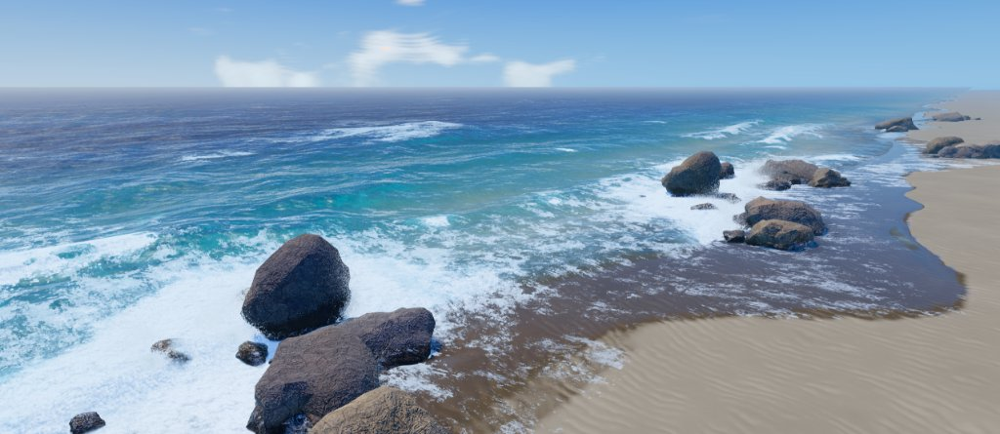
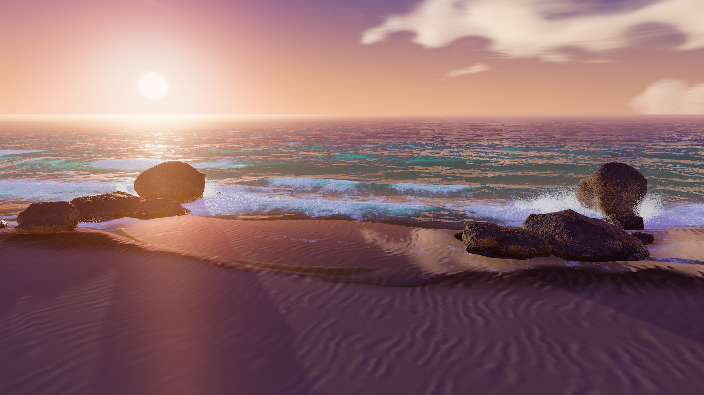
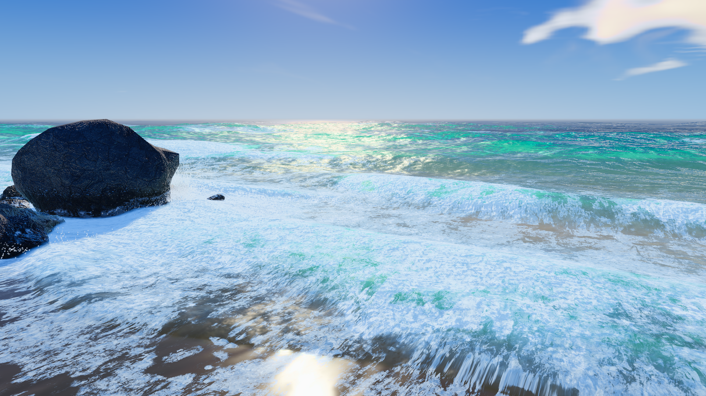
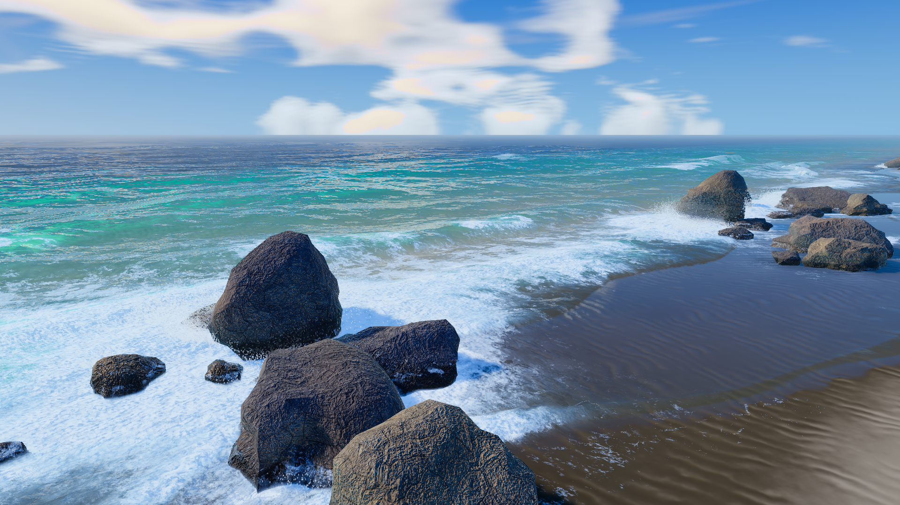
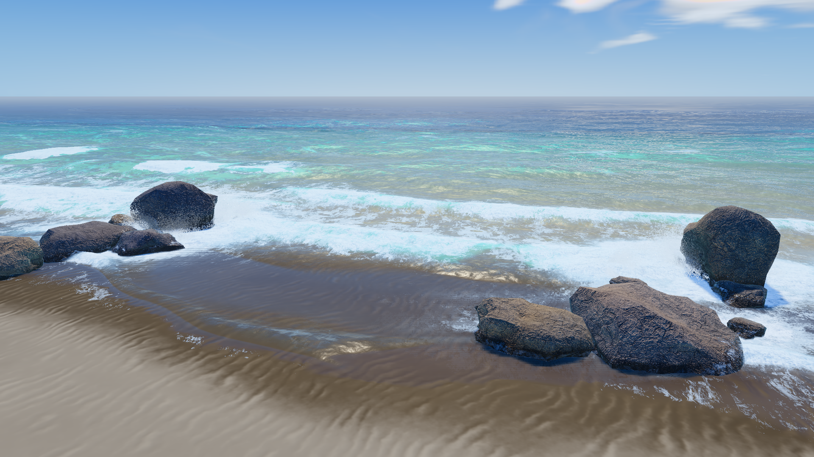
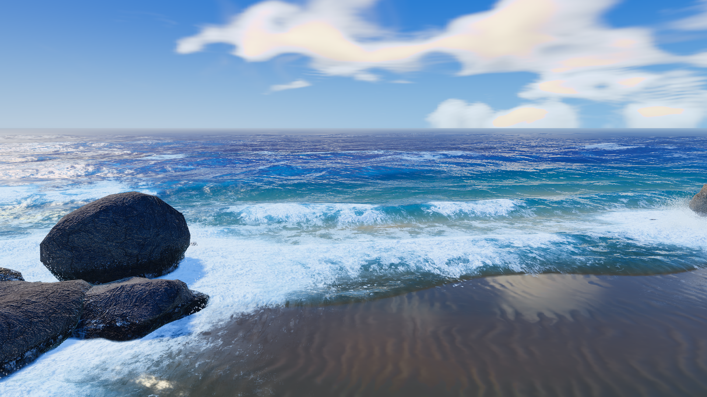
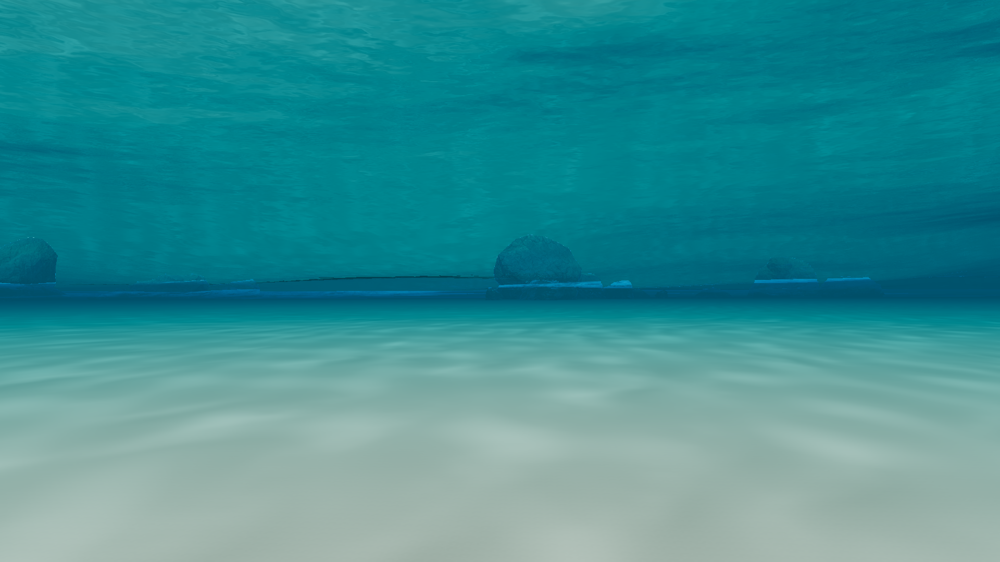
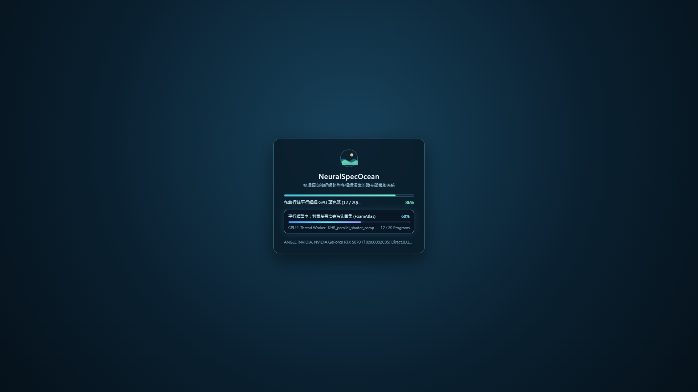
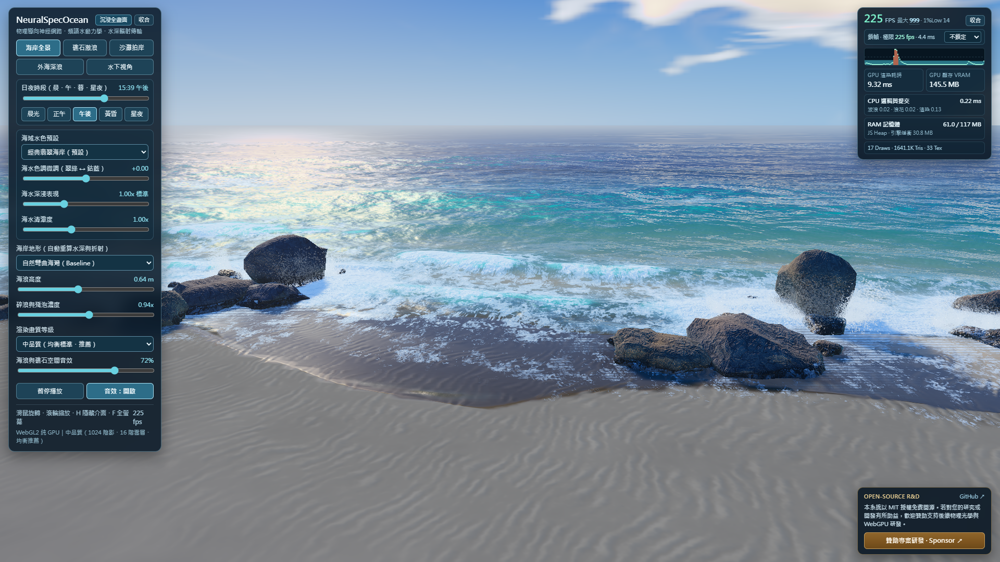

<div align="center">

# NeuralSpecOcean

**基於物理導向神經網路與多頻譜水動力學之 WebGL2 即時海岸海洋模擬系統**

[](https://bgbg108555.github.io/NeuralSpecOcean/)
[](https://github.com/bgbg108555/NeuralSpecOcean/releases)
[](./LICENSE)
[](https://bgbg108555.github.io/NeuralSpecOcean/)
[](https://portaly.cc/AlphaCore/support)

[**English (`README.md`)**](./README.md) | [**繁體中文**](./README.zh-TW.md) | [**技術白皮書 (`TECHNICAL_WHITEPAPER.md`)**](./TECHNICAL_WHITEPAPER.md) | [**線上展示**](https://bgbg108555.github.io/NeuralSpecOcean/) | [**專案贊助**](#專案贊助與研發支持)

---



</div>

---

## 摘要

**NeuralSpecOcean** 是一套基於原生 **WebGL2** 與作業系統多執行緒 **`Web Worker`** 實作之即時海岸水動力學、大氣輻射傳輸與水聲物理開放原始碼模擬系統。全系統封裝於單一無外部執行期相依性之 `2.14 MB` HTML 構件（[`index.html`](./index.html)）中，整合頻譜物理海洋學、二維非線性淺水偏微分方程（PDE）、海洋生物光學與線上訓練之物理導向神經網路（Physics-Informed Neural Networks, PINNs）。

專案名稱 **NeuralSpecOcean** 直接對應系統之兩大數理核心：
1. **物理導向神經算子（`Neural`）**：於啟動階段透過背景 `Web Worker` 執行緒即時訓練三組輕量化物理導向神經網路，結合 $W^{1,2}$ Sobolev 一階偏導數監督、精確正交權重初始化、冪迭代譜正規化（Spectral Normalization），以及強制滿足熱力學第一與第二定律（Clausius–Duhem 不等式）之歐幾里得凸集正交投影。
2. **多物理域頻譜方法（`Spec`）**：涵蓋三頻帶快速傅立葉變換（FFT）重力—毛細海浪頻譜、波長解析之 Case-1/Case-2 水體吸收與後向散射生物光譜、三波長色散海面曲率 Hessian 海底焦散，以及跨越 Hinze 湍流尺度之氣泡共振水聲頻譜。

- **瀏覽器即時互動展示**：https://bgbg108555.github.io/NeuralSpecOcean/
- **單一檔案離線執行版**：請見 [GitHub Releases](https://github.com/bgbg108555/NeuralSpecOcean/releases)（`NeuralSpecOcean-v1.0.0-Standalone.html`）
- **完整數學推導與參考文獻**：請參閱 [`TECHNICAL_WHITEPAPER.md`](./TECHNICAL_WHITEPAPER.md)

---

## 即時渲染結果

以下影像皆由 [`index.html`](./index.html) 於 `1920 x 1080` 解析度下即時運算輸出，未經任何後製處理。

| **夜間天體曆與 Gaia DR2 天體測量星場** | **Chapman–Ozone 球殼暮光輻射傳輸** |
| :---: | :---: |
|  |  |
| *月盤局部雲層邊緣散射與 $5 \times 5$ NMS 單像素恆星重建* | *平流層臭氧 Chappuis 吸收帶神經代理模型與濕沙薄水膜鏡面反射* |
| **波浪—礁岩拍擊與介電質飛沫系統** | **嚴格單調岸線微分同胚與近岸碎浪變形** |
|  |  |
| *熱力學守恆衝擊 PINN 與 262,144 顆 GPU 實例化介電質水滴* | *保向岸線座標變換（$ds/du \ge 0.3403 > 0$）消除近岸網格折疊偽影* |
| **淺海碳酸鹽潟湖生物光學** | **深海遠洋 Beer–Lambert 光譜衰減** |
|  |  |
| *低葉綠素淺水高散射透光與海床折射焦散* | *長波長紅光深度吸收與 GGX 微表面天穹反射* |
| **水下司乃耳窗全內反射與色散焦散** | **多執行緒非阻塞初始化管線** |
|  |  |
| *水下臨界角（$\theta_c \approx 48.56^\circ$）全內反射與三波長色散焦散* | *背景 `Web Worker` 神經網路訓練與 `KHR_parallel_shader_compile` 平行編譯* |

---

## 核心數理與系統架構

完整控制方程、神經網路架構圖與 28 篇同儕審查學術文獻請見 [`TECHNICAL_WHITEPAPER.md`](./TECHNICAL_WHITEPAPER.md)。

### 1. 三頻帶頻譜波場合成與嚴格單調岸線網格變換
海面高程與水平 Gerstner 位移由三個互質空間週期頻帶（長湧浪 $128^2$ `240 m`、短重力波 $64^2$ `28 m`、毛細重力碎波 $64^2$ `11.3 m`）合成，並受任意水深色散關係 $\omega(k, h) = \sqrt{(gk + (\sigma/\rho_w)k^3)\tanh(kh)}$ 約束。近岸網格透過平滑微分同胚 $s(u) = u - 0.21\sin(\pi u)$ 集中解析度於碎浪帶，其導數下界 $ds/du \ge 0.3403 > 0$ 在全定義域嚴格為正，確保三角形面積恆正且法線朝向一致。

### 2. 二維 GPU 非線性淺水方程求解器 (`SwashRigGPU`)
於 $512 \times 256$ 半精度浮點（`RGBA16F`）雙緩衝紋理上即時積分含底床摩阻與沙質滲流之二維非線性淺水方程組，模擬碎浪爬升（Run-up）、退潮回流（Backwash）、礁岩繞流與多相泡沫平流耗散。

### 3. 三組線上訓練物理導向神經網路 (`Sobolev-PINNs`)
啟動時於平行 `Web Worker` 執行緒內直接由物理方程進行無外部權重檔之監督與物理約束訓練：
- **Chapman–Ozone 球殼大氣透射率代理網路**（`2 -> 8 SiLU -> 6 Sigmoid`，78 參數）：採二維 Sobol 低差異序列與 $W^{1,2}$ Sobolev 偏導數損失訓練，精確近似瑞利散射、米氏氣膠散射與平流層臭氧 Chappuis 帶之球殼光學厚度積分。
- **礁岩邊界層多相泡沫殘差網路**（`6 -> 8 SiLU -> 8+Skip SiLU -> 3 Sigmoid`，187 參數）：權重打包為 `vec4` 陣列注入花崗岩片段著色器（[`CoastalRocks.js`](./source/src/CoastalRocks.js)），以單指令多資料流（SIMD）即時推論駐波壅水泡沫環、孔隙水膜暗化與退潮垂流條紋。
- **熱力學守恆波浪—礁岩衝擊與水滴破碎網路**（`9 -> Fourier(16) -> 16 -> 12+Skip -> 5` 耦合 `3 -> 4 -> 3` 頂點微網路）：結合 Saxe 正交初始化、Miyato 譜正規化（$\|W^{(l)}\|_2 \le L_{\max}$）與 Clausius–Duhem 熱力學單純形正交投影，在所有 Weber 與 Ohnesorge 無因次撞擊區間保證能量守恆與非負黏滯耗散（$\mathcal{D} > 0$，熱力學違例數為 `0`）。

### 4. 海洋生物光學與解析色散 Hessian 海底焦散
水體輻射傳輸依據波長相關吸收係數 $a(\lambda)$ 與後向散射係數 $b_b(\lambda)$ 建立五種標準水體光學預設；透過雙層深度剝離（Dual-Layer Depth Peeling）精確分離水下障礙物與海床折射，並於水下視角重現臨界角 $\theta_c = \arcsin(1/1.334) \approx 48.56^\circ$ 之司乃耳窗（Snell's Window）全內反射。海床焦散由折射波面高度 Hessian 矩陣行列式 $\det(\mathbf{I} + d_\lambda \mathbf{H}\eta)$ 結合三波段折射率 $n_{\text{RGB}} = (1.331, 1.334, 1.339)$ 解析求得。

### 5. 介電質飛沫粒子與氣泡共振水聲合成
- **介電質飛沫系統 (`RockSplashSystem`)**：以 GPU 實例化演進最多 262,144 顆水滴粒子，模擬水舌二次破碎、空氣阻力減速與米氏／彩虹相位散射。
- **程序化水聲物理合成 (`OceanAudio`)**：不依賴任何預錄音訊樣本，純以 WebAudio 雙二階濾波器組模擬 Minnaert 水下氣泡絕熱共振（$f_0 \propto R_0^{-1}$）與 Deane–Stokes 跨越 Hinze 尺度（$a_H \approx 1.0\text{ mm}$）之雙冪律氣泡粒徑聲譜。

### 6. 感知色彩科學與多執行緒平行著色器編譯
- **Oklab–AgX 色調映射 (`CinemaPostPass`)**：於 Björn Ottosson 之感知均勻 Oklab 色彩空間執行內縮色域壓縮與恆定色相高光去飽和，消除傳統逐通道 RGB 色調映射於高亮度水面與夕陽反射處之色相偏移。
- **非阻塞平行編譯管線**：精確對齊離屏線性 HDR 與螢幕 sRGB 畫布之 Three.js `programCacheKey` 雜湊，將全系統 20 組獨立 `WebGLProgram` 透過 `KHR_parallel_shader_compile` 非阻塞提交至顯示卡驅動背景執行緒池編譯，使冷啟動總耗時由同步基線之 `29.75 s` 降至 `14.29 s`。

---

## 硬體效能與記憶體實測數據

以下數據由自動化測試腳本 [`tools/verify_gpu_render.mjs`](./tools/verify_gpu_render.mjs) 於 **NVIDIA GeForce RTX 5070 Ti**（`ANGLE Direct3D11`、`1600 x 960` 視窗、`gl.finish()` 硬體全同步量測）實測取得：



| 畫質預設等級 | 渲染解析度倍率 (DPR) | 活躍三角形數 | Draw Calls | GPU 顯存 (VRAM) | JS 堆積記憶體 | 平均全同步 GPU 幀耗時 | 未鎖幀吞吐率 |
| :--- | :---: | :---: | :---: | :---: | :---: | :---: | :---: |
| **低品質 (Low)** | `1.00x` | `1.13M` | `17` | `106.8 MB` | `68.9 MB` | `1.54 ms` | `~650 FPS` |
| **中品質 (Medium, 預設)** | `1.20x` | `1.71M` | `17` | `149.9 MB` | `68.9 MB` | `1.51 ms` | `~661 FPS` |
| **高品質 (High)** | `1.45x` | `2.34M` | `19` | `323.6 MB` | `68.9 MB` | `1.60 ms` | `~627 FPS` |

- **冷啟動遙測指標**：`20 / 20` 組去重後之 WebGL2 著色器程式全數經 `KHR_parallel_shader_compile` 非阻塞平行編譯完成（主執行緒提交耗時 `13.1 ms`）、`2` 個並行 `Web Worker` 執行緒、`0` 著色器編譯或連結錯誤。

---

## 執行與原始碼建置方式

### 1. 線上直接執行
使用支援 WebGL2 之桌面或行動瀏覽器開啟 https://bgbg108555.github.io/NeuralSpecOcean/。

### 2. 單一檔案離線執行
前往 [GitHub Releases](https://github.com/bgbg108555/NeuralSpecOcean/releases) 下載 `NeuralSpecOcean-v1.0.0-Standalone.html`（或直接開啟儲存庫根目錄之 [`index.html`](./index.html)），無須本地伺服器或網路連線即可直接於瀏覽器執行。

### 3. 由模組化原始碼重新建置
將 [`source/`](./source/) 編譯為單一檔案 [`index.html`](./index.html) 僅需 **Python 3.8+** 標準庫（無須安裝任何第三方套件）：

```bash
git clone https://github.com/bgbg108555/NeuralSpecOcean.git
cd NeuralSpecOcean
python source/build.py

# （選用）執行無頭 Chromium 自動化 GPU 驗證與效能基準測試：
node tools/verify_gpu_render.mjs
```

---

## 互動控制與診斷介面

| 輸入／控制項 | 功能說明 |
| :--- | :--- |
| **滑鼠左鍵拖曳／單指觸控** | 環繞調整攝影機方位角與仰角（具備波面與地形高度防穿模抬升約束） |
| **滑鼠滾輪／雙指縮放** | 連續縮放視距（涵蓋 `3 m` 微觀泡沫結構至 `180 m` 海灣尺度） |
| **`H` 鍵** | 切換純淨畫面模式（隱藏所有控制面板與遙測介面） |
| **`F` 鍵** | 切換原生全螢幕顯示模式 |
| **視角預設按鈕** | 平滑切換 *海岸全景*、*礁石激浪*、*沙灘拍岸*、*外海深浪* 與 *水下視角* |
| **日夜時段滑桿 (`00:00–24:00`)** | 連續調整太陽與月球天體軌跡及對應大氣輻射傳輸狀態 |
| **海域水色與光學參數** | 切換五種水體生物光學預設，並連續微調光譜色調、光學深度倍率與清澈度 |
| **`window.oceanDebug.status()`** | 於瀏覽器開發者主控台讀取 PINN 熱力學狀態、著色器平行編譯統計與顯存配置 |

---

## 專案贊助與研發支持

**NeuralSpecOcean** 以開放之 [MIT License](./LICENSE) 釋出，旨在促進即時流體力學、海洋光學渲染與瀏覽器端科學機器學習（SciML）之研究與工程交流。

若本專案對您的研究、教學或工程開發有所助益，歡迎透過以下管道支持後續研發工作（包含 WebGPU Compute Shader 色散波浪求解器、真實全球海岸地形高程串流與技術文件維護）：

- **專案贊助頁面（支援國內外信用卡）**：https://portaly.cc/AlphaCore/support（亦可透過儲存庫頂端由 [`.github/FUNDING.yml`](./.github/FUNDING.yml) 啟用之 **Sponsor** 按鈕前往）

---

## 學術引用 (Citation)

若於學術論文、技術報告或衍生專案中引用 **NeuralSpecOcean**，請使用以下 BibTeX 格式：

```bibtex
@software{neuralspecocean2026,
  author       = {bgbg108555},
  title        = {{NeuralSpecOcean}: Physics-Informed Neural and Multi-Spectral Coastal Ocean Simulation in WebGL2},
  year         = {2026},
  url          = {https://github.com/bgbg108555/NeuralSpecOcean},
  license      = {MIT}
}
```

---

## 授權條款

本專案採用 [MIT License](./LICENSE) 授權。第三方開源函式庫（Three.js）與公開領域科學星表資料（NASA SVS 4851 / ESA Gaia DR2）之歸屬聲明請參閱 [`THIRD_PARTY_NOTICES.md`](./THIRD_PARTY_NOTICES.md)。
