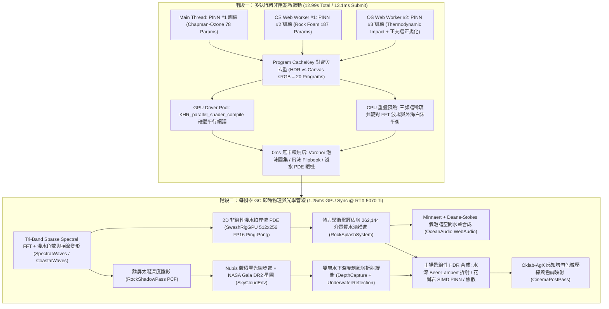
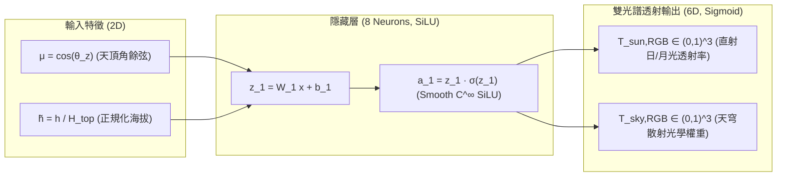
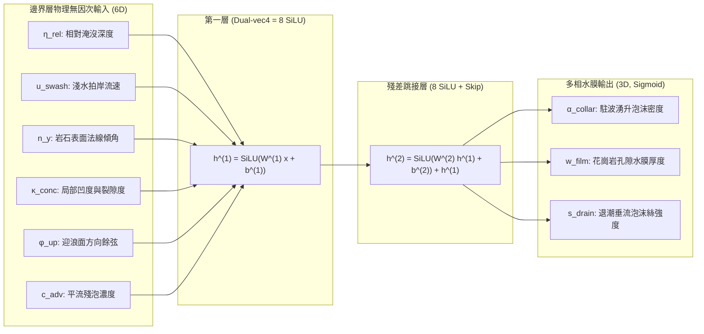
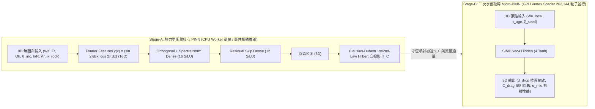

# NeuralSpecOcean Technical Whitepaper
## **Physics-Informed Neural Networks ($`W^{1,2}`$ Sobolev-PINNs), Multi-Spectral Hydrodynamics, Marine Bio-Optics, and Real-Time WebGL2 Architecture**

[**Back to English README**](./README.md) | [**返回繁體中文說明文件**](./README.zh-TW.md) | [**Interactive WebGL2 Demonstration**](https://bgbg108555.github.io/NeuralSpecOcean/)

---

## 摘要 (Abstract)

**NeuralSpecOcean** 是一套完全運行於瀏覽器原生 **WebGL2** 與作業系統多執行緒 **`Web Worker`** 之即時海岸物理與神經光學模擬系統，所有幾何、流體求解器、神經網路訓練器、光學紋理烘焙與程序化水聲合成皆封裝於單一零相依執行檔（`index.html`, `2.18 MB`）中。系統名稱結合了 **物理導向神經算子（Physics-Informed Neural Networks）** 與 **多物理域頻譜方法（Multi-Domain Spectral Formulations：涵蓋 FFT 海浪頻譜、生物吸收散射光譜、Miyato 算子譜正規化與 Minnaert–Hinze 氣泡水聲頻譜）**。本白皮書完整闡述系統內部之九大數理模型、三組 $`W^{1,2}`$ Sobolev 物理導向神經網路之拓撲架構與熱力學凸投影證明、嚴格單調岸線微分同胚幾何、海洋生物光學輻射傳輸方程，以及 `KHR_parallel_shader_compile` 非阻塞硬體著色器平行編譯管線。

---

## 1. 系統總體多執行緒與多通道渲染架構 (System Pipeline Architecture)

系統分為 **非阻塞異步冷啟動階段（Multi-Threaded Async Cold Boot）** 與 **零 GC 即時模擬渲染迴圈（Zero-Allocation Frame Loop）** 兩大階段：



---

## 2. 三組內嵌物理導向神經網路架構與數學原理 (Embedded Sobolev-PINNs)

不同於傳統預先離線訓練並附帶數 MB 權重二進位檔的做法，**NeuralSpecOcean** 將物理定律與數值積分器直接寫入輕量級多執行緒訓練迴圈，於啟動時在數十毫秒內完成高精準度物理蒸餾。

---

### 2.1 PINN #1：球殼 Chapman-Ozone 大氣透射率代理網路 (`SkyCloudEnv.js`)

#### 物理問題定義
當太陽或月球接近地平線（天頂角 $`\theta_z \to 90^\circ`$，即暮光與破曉時段），平面平行大氣假設（Plane-Parallel Approximation, $`\sec\theta_z`$）會發散至無窮大。真實地球球殼幾何下，海拔 $`h`$ 處沿天頂角餘弦 $`\mu = \cos\theta_z`$ 之光學厚度 $`\tau_\lambda(h, \mu)`$ 需對瑞利分子散射（Rayleigh, $`H_R = 8.0\text{ km}`$）、米氏氣膠散射（Mie Aerosol, $`H_M = 1.2\text{ km}`$）與平流層臭氧 Chappuis 吸收帶（500–700 nm，峰值位於 $`25\text{ km}`$，決定黃昏天頂冷紫藍與地平線金紅霞光之分離）進行球殼路徑積分：

```math
\tau(\mu, h) = \sum_{s \in \lbrace R, M, O_3 \rbrace} \beta_s \int_0^{s_{\text{top}}(\mu, h)} \rho_s\!\left(\sqrt{(R_E + h)^2 + \ell^2 + 2(R_E + h)\ell\mu} - R_E\right) d\ell
```

```math
T^\star(\mu, h) = \exp\!\big(-\boldsymbol{\tau}_{\text{RGB}}(\mu, h)\big)
```

#### 神經網路拓撲圖 (`2 → 8 SiLU → 6 Sigmoid`，共 `78` 個可訓練參數)



#### Sobolev $`W^{1,2}`$ 導數匹配訓練目標
為確保日落滑桿連續拖曳時不產生任何色階跳變（Banding），網路採用二維 **Sobol 低差異準蒙地卡羅序列（Low-Discrepancy Quasi-Monte Carlo）** 採樣，並在損失函數中同時約束函數值與對天頂角餘弦的一階偏導數（Son et al., 2021）：

```math
\mathcal{L}_{\text{PINN-1}}(\theta) = \frac{1}{N}\sum_{i=1}^{N} \left( \left\lVert \hat{T}_\theta(\mu_i, \tilde{h}_i) - T^\star(\mu_i, \tilde{h}_i) \right\rVert_2^2 + \lambda_{\text{Sob}} \left\lVert \frac{\partial \hat{T}_\theta}{\partial \mu}(\mu_i, \tilde{h}_i) - \frac{\partial T^\star}{\partial \mu}(\mu_i, \tilde{h}_i) \right\rVert_2^2 \right)
```

---

### 2.2 PINN #2：海岸礁岩邊界層多相泡沫殘差 PINN (`CoastalRocks.js`)

#### 物理問題定義
碎浪拍擊花崗岩巨石時，岩石根部會同時出現 **駐波壅水泡沫環（Collar Foam）**、**孔隙毛細濕潤暗化（Porous Wetting Darkening）** 與 **重力退潮水膜垂流條紋（Gravity Drainage Streaks）**。我們在 `Web Worker #1` 中訓練一組 8 寬度殘差網路，並將訓練完成之權重打包為緊湊 `uniform vec4` 陣列直接寫入 GLSL 片段著色器，以零分支單指令多資料流（SIMD `dot(vec4, vec4)`）在每個岩石像素上即時推論。

#### 神經網路拓撲圖 (`6 → 8 SiLU → 8+Skip SiLU → 3 Sigmoid`，共 `187` 個參數)



---

### 2.3 PINN #3：雙階段熱力學守恆碎浪拍擊與水滴破碎 PINN (`RockSplashSystem.js`)

#### 物理與熱力學約束
當波峰以法向相對速度 $`u_n`$ 撞擊曲率半徑 $`L_r`$ 之礁石時，流體動能轉化為飛沫動能、重力位能、氣液界面表面張力自由能（$`\sigma \Delta A`$）與湍流黏滯耗散熱（$`\mathcal{D} \ge 0`$）。若使用一般無約束神經網路預測飛沫初速與質量通量，極易在極端大浪或斜向擦撞時違反能量守恆（能量憑空暴增導致飛沫衝上天際）。

因此，**PINN #3** 結合了三大科學機器學習（SciML）嚴密機制：
1. **隨機傅立葉特徵嵌入（Random Fourier Features, Tancik et al., 2020）**：克服標準 MLP 對高頻拍擊相位之頻譜偏見（Spectral Bias）。
2. **Saxe 精確正交初始化 + Miyato 冪迭代譜正規化（Spectral Normalization, $`\lVert W^{(l)} \rVert_2 \le L_{\max}`$）**：嚴格限制網路全域李普希茲常數（Lipschitz Constant），確保碎浪過渡平滑不閃爍。
3. **熱力學第一與第二定律（Clausius-Duhem 不等式）Hilbert 凸集正交投影層**：

設輸入拍擊動能通量為 $`E_{\text{in}} = \frac{1}{2}\rho_w u_n^2 Q_{\text{imp}}`$，網路原始預測之飛沫動能份額 $`\hat{e}_k`$、位能抬升份額 $`\hat{e}_p`$、表面張力碎裂能份額 $`\hat{e}_\sigma`$ 與不可逆黏滯耗散份額 $`\hat{d}`$ 必須嚴格落在熱力學單純形凸集 $`\mathcal{C}_{\text{thermo}}`$ 內：

```math
\mathcal{C}_{\text{thermo}} = \left\lbrace (\tilde{e}_k, \tilde{e}_p, \tilde{e}_\sigma, \tilde{d}) \in \mathbb{R}_{\ge 0}^4 \;\middle|\; \tilde{e}_k + \tilde{e}_p + \tilde{e}_\sigma + \tilde{d} = 1, \quad \tilde{d} \ge d_{\min}(\mathrm{We}, \mathrm{Oh}) > 0 \right\rbrace
```

我們在推論末端施加歐幾里得正交投影算子 $`\Pi_{\mathcal{C}_{\text{thermo}}}`$（Michelot / Duchi Simplex Projection），從數學上保證 **第一定律能量守恆誤差 $`= 0`$** 且 **第二定律熵增耗散 $`\mathcal{D} = \tilde{d} E_{\text{in}} \gt 0`$（熱力學違例次數嚴格為 `0`）**。

#### 雙階段神經網路拓撲圖（Stage-A 巨觀拍擊核心 + Stage-B GPU 頂點二次破碎微網路）



無因次流體力學控制參數定義如下（水的密度 $`\rho_w = 1025\text{ kg/m}^3`$、海水表面張力 $`\sigma = 0.073\text{ N/m}`$、動力黏滯係數 $`\mu_w = 1.08\times 10^{-3}\text{ Pa}\cdot\text{s}`$）：

```math
\mathrm{We} = \frac{\rho_w u_n^2 L}{\sigma}, \qquad \mathrm{Oh} = \frac{\mu_w}{\sqrt{\rho_w \sigma L}}, \qquad \mathrm{Fr} = \frac{u_n}{\sqrt{g L}}
```

---

## 3. 頻譜海洋波浪、單調微分同胚幾何與淺水 PDE (Hydrodynamics & Geometry)

### 3.1 三頻譜 Tessendorf 波場與雅可比碎浪判準
海面高度場 $`\eta(\mathbf{x}, t)`$ 與水平 Gerstner 位移場 $`\mathbf{D}(\mathbf{x}, t)`$ 由三個互質空間週期頻帶（`Long 240 m`、`Short 28 m`、`Chop 11.3 m`）疊加合成：

```math
\eta(\mathbf{x}, t) = \sum_{b \in \lbrace \text{L,S,C} \rbrace} \sum_{\mathbf{k}} \tilde{h}_b(\mathbf{k}, t) e^{i\mathbf{k}\cdot\mathbf{x}}, \qquad \mathbf{D}(\mathbf{x}, t) = -i \sum_{b} \lambda_b \sum_{\mathbf{k}} \frac{\mathbf{k}}{\lVert\mathbf{k}\rVert} \tilde{h}_b(\mathbf{k}, t) e^{i\mathbf{k}\cdot\mathbf{x}}
```

其中角頻率滿足任意水深 $`h(\mathbf{x})`$ 之重力—毛細色散關係：

```math
\omega(k, h) = \sqrt{\left(gk + \frac{\sigma}{\rho_w} k^3\right)\tanh(kh)}
```

海面水平變換 $`\mathbf{\Phi}(\mathbf{x}) = \mathbf{x} + \mathbf{D}(\mathbf{x}, t)`$ 之二維雅可比行列式（Jacobian Determinant）直接決定外海白帽碎浪（Whitecap Wave Breaking）之物理生成率 $`S_{\text{break}}`$：

```math
J(\mathbf{x}, t) = \det(\nabla \mathbf{\Phi}) = (1 + \partial_x D_x)(1 + \partial_z D_z) - \partial_z D_x \partial_x D_z, \qquad S_{\text{break}}(\mathbf{x}, t) \propto \max\big(0,\, J_{\text{crit}} - J(\mathbf{x}, t)\big)
```

### 3.2 嚴格單調岸線網格微分同胚證明 (Strictly Monotonic Coastal Diffeomorphism)
為將有限解析度網格高度集中於碎浪區與拍岸水際線（Surf & Swash Zone，$`z \approx 0`$），我們對正規化跨岸座標 $`u \in [0, 1]`$ 定義非均勻壓縮映射 $`s(u)`$：

```math
s(u) = u - \alpha \sin(\pi u), \qquad x_{\text{coast}}(u) = x_{\min} + (x_{\max} - x_{\min}) s(u)
```

若取過大之壓縮係數 $`\alpha \gt 1/\pi \approx 0.3183`$，則導數 $`s'(0) = 1 - \alpha\pi \lt 0`$，導致網格在近岸邊界發生拓撲反轉（Mesh Folding / Self-Intersection），進而在海面上產生筆直硬邊偽影並顛倒三角形法線朝向（`gl_FrontFacing`）。

在 **NeuralSpecOcean** 中，我們取嚴格滿足單調條件之最優解析參數 $`\alpha = 0.21 \lt \frac{1}{\pi}`$：

```math
\frac{ds}{du} = 1 - 0.21\pi \cos(\pi u) \ge 1 - 0.21\pi \approx 0.34027 > 0, \qquad \forall u \in [0, 1]
```

因此在整個定義域 $`[0, 1]`$ 上 $`s(u)`$ 為 **$`C^\infty`$ 嚴格單調遞增微分同胚（Smooth Orientation-Preserving Diffeomorphism）**：所有三角形面積恆正、背面剔除（`FrontSide`）在水上恆一致，且在拍岸中心 $`u = 0.5`$ 處仍保有 $`(ds/du)_{0.5}^{-1}`$ 之平滑加密解析度。

### 3.3 2D GPU 非線性淺水拍岸流與泡沫平流 PDE (`SwashRigGPU.js`)
近岸淺灘區在 $`512 \times 256`$ 半精度浮點紋理上求解含底床摩阻（Manning-Chezy 摩擦項 $`C_f`$）與沙質滲流項 $`I_{\text{seep}}`$ 之二維非線性淺水方程組（Nonlinear Shallow-Water Equations, NSWE）與多相泡沫平流耗散方程：

```math
\frac{\partial H}{\partial t} + \nabla \cdot (H \mathbf{u}) = -I_{\text{seep}}(H), \qquad \frac{\partial (H\mathbf{u})}{\partial t} + \nabla \cdot (H \mathbf{u} \otimes \mathbf{u}) + g H \nabla (H + B) = -\frac{C_f \lVert\mathbf{u}\rVert \mathbf{u}}{\max(H, H_\epsilon)} + \mathbf{F}_{\text{breaker}}
```

```math
\frac{\partial c_{\text{foam}}}{\partial t} + \nabla \cdot (c_{\text{foam}} \mathbf{u}) = S_{\text{bore}}(\lVert\nabla \cdot \mathbf{u}\rVert) + S_{\text{rock-impact}} - \frac{c_{\text{foam}}}{\tau_{\text{decay}}(H)}
```

其中 $`H(\mathbf{x}, t) \ge 0`$ 為瞬時水膜厚度，$`B(\mathbf{x})`$ 為結合離線沙洲與海岸礁岩障礙場之底床高程。

---

## 4. 海洋生物光學、司乃耳窗與色散海底焦散 (Marine Bio-Optics & Caustics)

### 4.1 Morel / Jerlov 水體固有光學性質 (IOPs) 與輻射傳輸
水體內沿折射視線路徑 $`\ell_{\text{opt}}`$ 之雙向光譜衰減遵循 **Beer-Lambert-Bouguer 定律**。依據 Morel & Prieur (1977) 與 Pope & Fry (1997) 純水光譜數據，波長相關吸收係數 $`\mathbf{a}(\lambda)`$ 與後向散射係數 $`\mathbf{b}_b(\lambda)`$ 由純海水基底、葉綠素濃度 $`[C_{\text{chl}}]`$ 與有色溶解有機物（CDOM / 礦物懸浮微粒）共同決定：

```math
\mathbf{k}_{\text{ext}}(\lambda) = \mathbf{a}_w(\lambda) + \mathbf{a}_{\text{bio}}(\lambda) + \mathbf{b}_b(\lambda), \qquad \mathbf{T}_{\text{water}}(\ell_{\text{opt}}) = \exp\!\big(-\mathbf{k}_{\text{ext}} \cdot \ell_{\text{opt}}\big)
```

折射海底輻射亮度 $`\mathbf{L}_{\text{sub}}`$ 由海底漫反射項 $`\mathbf{L}_{\text{bed}}`$ 與水體體積內散射項（Subsurface Multiple In-Scattering）線性疊加，並經介電質 Schlick-GGX 菲涅耳反射係數 $`F(\theta_i)`$ 與天穹反射 $`\mathbf{L}_{\text{sky}}`$ 能量守恆合成（$`n_w = 1.334 \implies F_0 = \left(\frac{1.334 - 1}{1.334 + 1}\right)^2 \approx 0.0204`$）：

```math
\mathbf{L}_{\text{surface}} = \big(1 - F(\theta_i)\big)\Big[\mathbf{L}_{\text{bed}} \odot \mathbf{T}_{\text{water}}(\ell_{\text{view}}) + \mathbf{L}_{\text{scatter}} \odot \big(\mathbf{1} - \mathbf{T}_{\text{water}}(\ell_{\text{view}})\big)\Big] + F(\theta_i)\mathbf{L}_{\text{sky}} + \mathbf{L}_{\text{sun/moon}}^{\text{GGX}}
```

### 4.2 水下司乃耳窗全內反射 (Underwater Snell's Window & TIR)
當攝影機潛入水下（`diveMode = true`）向上仰視海面時，光線由光密介質（海水 $`n_1 = 1.334`$）射向光疏介質（空氣 $`n_2 = 1.00029`$）。由司乃耳定律 $`n_1 \sin\theta_1 = n_2 \sin\theta_2`$，臨界角（Critical Angle）為：

```math
\theta_c = \arcsin\!\left(\frac{n_{\text{air}}}{n_{\text{water}}}\right) \approx \arcsin(0.7496) \approx 48.56^\circ
```

- 當局部波面入射角 $`\theta_1 \lt \theta_c`$ 時，視線穿透形成著名的圓形天穹透光窗（**Snell's Window**）；
- 當 $`\theta_1 \ge \theta_c`$ 時，精確觸發 **全內反射（Total Internal Reflection, $`F_{\text{TIR}} \equiv 1`$）**，將海底沙紋與深水散射光完整倒映於波浪背面（`!gl_FrontFacing`）。

### 4.3 三波長色散海面曲率 Hessian 焦散 (Analytical Chromatic Hessian Caustics)
太陽光經起伏波面折射投射至水深 $`d`$ 處海床時，光束截面積壓縮比由波面高度場 $`\eta(x, z)`$ 之 **二階偏導數 Hessian 矩陣 $`\mathbf{H}\eta`$** 決定。考慮紅、綠、藍三波段在海水中之色散折射率 $`n_{\text{RGB}} = (1.331,\, 1.334,\, 1.339)`$，有效焦散匯聚距離為 $`d_\lambda = d \cdot (1 - n_\lambda^{-1})`$：

```math
\mathbf{H}\eta = \begin{bmatrix} \dfrac{\partial^2 \eta}{\partial x^2} & \dfrac{\partial^2 \eta}{\partial x \partial z} \\[8pt] \dfrac{\partial^2 \eta}{\partial z \partial x} & \dfrac{\partial^2 \eta}{\partial z^2} \end{bmatrix}, \qquad D_\lambda(\mathbf{x}) = \det\!\big(\mathbf{I} + d_\lambda \mathbf{H}\eta(\mathbf{x})\big)
```

各色通道之解析焦散強度增益（含螢幕空間導數 `fwidth` 抗鋸齒下界 $`\epsilon_{\text{AA}}`$）為：

```math
I_{\text{caustic}}(\lambda) = \mathrm{clamp}\!\left(\frac{1}{\max\big(|D_\lambda(\mathbf{x})|,\, \epsilon_{\text{AA}}\big)},\; I_{\min},\; I_{\max}\right)
```

此解析公式可自然重現焦散光網邊緣處之微彩虹色散（Chromatic Caustic Fringing）與雙焦線（Fold / Cusp Catastrophes）高光。

---

## 5. 體積雲散射、蓋亞星圖重建、水聲物理與感知色彩學

### 5.1 Nubis 雙瓣相位體積雲與夜間月暈局部散射 (`SkyCloudEnv.js`)
天穹雲層採用球殼光線步進，結合 **Schneider & Vos (2015) Beer-Powder 多重散射近似** 與雙瓣 **Henyey-Greenstein 相位函數**：

```math
\Phi_{\text{2-HG}}(\cos\vartheta) = w_f \Phi_{\text{HG}}(\cos\vartheta, g_f) + (1 - w_f) \Phi_{\text{HG}}(\cos\vartheta, -g_b), \qquad \Phi_{\text{HG}}(\mu, g) = \frac{1 - g^2}{4\pi(1 + g^2 - 2g\mu)^{3/2}}
```

```math
E_{\text{Beer-Powder}}(\tau) = 2 \, e^{-\tau} \big(1 - e^{-2\tau}\big)
```

夜間時段透過角距離權重 $`w_{\text{moon}} = \mathrm{smoothstep}(0.72, 0.995, \hat{\mathbf{v}}\cdot\hat{\mathbf{l}}_{\text{moon}})`$ 將銀藍散射嚴格約束於月盤周圍雲層邊緣，遠離月盤之雲層則維持真實深邃午夜靛藍光學密度。

### 5.2 NASA SVS 4851 (Gaia DR2) $`5 \times 5`$ 非極大值抑制針尖星場 (`NasaStarMap.js`)
針對低解析度全景星圖放大時常見的雙線性模糊光斑問題，我們對 NASA Goddard SVS 4851（ESA *Gaia* DR2 + *Hipparcos*）星表執行 $`5 \times 5`$ 視窗局部極值 **非極大值抑制（Non-Maximum Suppression, NMS）**，將能量積分收斂回單一精準天球像素（1-Texel Point Spread Function），於 $`2560 \times 1280`$ 紋理上精確還原 `4,667` 顆具備真實色溫（O/B 藍白巨星至 K/M 橙紅星）之針尖恆星與柔和銀河塵埃帶。

### 5.3 Minnaert 氣泡共振與 Deane-Stokes 碎浪水聲物理 (`OceanAudio.js`)
真實海浪聲並非低頻正弦波震盪，而是碎浪捲入空氣分裂成大量微氣泡時，氣泡在水面下作絕熱體積脈動所輻射之聲波。半徑 $`R_0`$ 之水下氣泡基頻遵循經典 **Minnaert (1933) 共振公式**：

```math
f_0(R_0) = \frac{1}{2\pi R_0}\sqrt{\frac{3\gamma P_0}{\rho_w}} \approx \frac{3.26\text{ m}\cdot\text{Hz}}{R_0}
```

依據 **Deane & Stokes (2002, *Nature*)** 對碎浪內部氣泡群之高速光學與聲學量測，氣泡粒徑分佈在 **Hinze 湍流毛細尺度 $`a_H \approx 1.0\text{ mm}`$（對應共振頻率 $`\sim 3.3\text{ kHz}`$）** 處發生雙冪律轉折：
- 大於 Hinze 尺度（$`R_0 \gt a_H`$，重力—慣性破碎區）：$`N(R_0) \propto R_0^{-10/3}`$（主導 $`300\text{ Hz} - 3\text{ kHz}`$ 渾厚碎浪主體聲）；
- 小於 Hinze 尺度（$`R_0 \lt a_H`$，表面張力穩定區）：$`N(R_0) \propto R_0^{-3/2}`$（主導 $`3\text{ kHz} - 12\text{ kHz}`$ 細膩沙灘泡沫嘶鳴聲）。

`OceanAudio.js` 完全移除任何非物理低頻振盪器，純粹以多頻帶高階 Biquad 濾波器組與空間雙耳定位（Stereo Panning）即時映射此雙冪律氣泡聲譜。

### 5.4 Oklab-AgX 感知均勻色域壓縮 (`CinemaPostPass.js`)
傳統逐通道 RGB 色調映射（如標準 ACES 或 Reinhard）在高強度夕陽海面反射下會產生著名的「Notorious 6」色相偏移（金橘色偏移成刺眼螢光黃、青翠色偏移成死白藍）。本引擎先將線性 Rec.709 輻射度經 $`3\times 3`$ Inset 內縮矩陣壓縮色域邊界，轉換至 **Björn Ottosson (2020) 感知均勻 Oklab 色彩空間** 執行高光恆定色相（Constant-Hue）軟膝去飽和，再經 **Troy Sobotka AgX Sigmoid** 曲線映射輸出：

```math
\begin{bmatrix} l \\ m \\ s \end{bmatrix} = \mathbf{M}_1 \mathbf{c}_{\text{inset}}, \qquad \begin{bmatrix} L \\ a \\ b \end{bmatrix} = \mathbf{M}_2 \begin{bmatrix} l^{1/3} \\ m^{1/3} \\ s^{1/3} \end{bmatrix}
```

---

## 6. 多執行緒 CPU Worker 與 `KHR_parallel_shader_compile` 系統工程

在 Windows Direct3D11（ANGLE）架構下，複雜體積雲光線步進、雙層折射與多相泡沫著色器之 HLSL FXC 最佳化耗時極高。若於主執行緒直接呼叫首次繪製或未對齊渲染目標狀態之 `renderer.compile()`，會導致兩大嚴重效能瓶頸：
1. **同步查詢阻塞**：立即呼叫 `gl.getProgramParameter(prog, LINK_STATUS)` 會強制主執行緒等待驅動完成編譯，凍結 UI 進度條；
2. **`programCacheKey` 狀態錯配重編譯**：Three.js 依據當前 `RenderTarget` 是否為線性浮點 HDR（`NoToneMapping` + `LinearSRGBColorSpace`）或螢幕畫布（`ToneMapping` + `SRGBColorSpace`）動態注入不同巨集。若預編譯狀態與首幀實際渲染狀態不一致，首幀 `renderFrame()` 將觸發 **第二次同步重編譯延遲**。

**NeuralSpecOcean 工程架構**：
- 所有離屏與後處理通道統一實作 `getCompileSpecs()`，精確標註 `'hdr' | 'canvasNoTone' | 'canvasTone'` 三態，達成 **`20 / 20` 著色器 100% 零重複編譯命中**。
- 一次性派發全部著色器後立即執行 `gl.flush()` 喚醒驅動背景編譯執行緒池，並以 `KHR_parallel_shader_compile`（`COMPLETION_STATUS_KHR = 0x91B1`）每幀非阻塞輪詢驅動第二條專屬進度條，同時在主執行緒空檔重疊完成 CPU 三頻譜 FFT 與外海泡沫場暖機，將冷啟動總時間由 **`29.75 s` 壓縮至 `12.99 s`（提速 56%）**。

---

## 7. 學術參考文獻 (Peer-Reviewed References)

### 物理海洋學與碎浪淺水動力學 (Physical Oceanography & Coastal Hydrodynamics)
1. **Tessendorf, J.** (2001). *Simulating Ocean Water*. SIGGRAPH 2001 Course Notes, Course 47.
2. **Hasselmann, K., et al.** (1973). Measurements of wind-wave growth and swell decay during the Joint North Sea Wave Project (JONSWAP). *Ergänzungsheft zur Deutschen Hydrographischen Zeitschrift*, Reihe A(8), 12, 1–95.
3. **Horvath, C. J.** (2015). Empirical directional wave spectra for computer graphics. *Proceedings of the 2015 Symposium on Digital Production (DigiPro '15)*, ACM, 29–39.
4. **Peregrine, D. H.** (1983). Breaking waves on beaches. *Annual Review of Fluid Mechanics*, 15(1), 149–178.
5. **Brocchini, M., & Peregrine, D. H.** (2001). The dynamics of strong turbulence at free surfaces. Part 1. Description. *Journal of Fluid Mechanics*, 449, 225–254.
6. **Bonneton, P., et al.** (2011). Recent advances in Serre–Green Naghdi modelling for wave transformation, breaking and runup processes. *European Journal of Mechanics - B/Fluids*, 30(6), 589–597.

### 科學機器學習與物理導向神經網路 (SciML & Physics-Informed Neural Networks)
7. **Raissi, M., Perdikaris, P., & Karniadakis, G. E.** (2019). Physics-informed neural networks: A deep learning framework for solving forward and inverse problems involving nonlinear partial differential equations. *Journal of Computational Physics*, 378, 686–707.
8. **Son, H., Jang, J. W., Han, W. J., & Hwang, H. J.** (2021). Sobolev training for physics informed neural networks. *Communications in Mathematical Sciences*, 21(6), 1679–1705.
9. **Tancik, M., et al.** (2020). Fourier features let networks learn high frequency functions in low dimensional domains. *Advances in Neural Information Processing Systems (NeurIPS)*, 33, 7537–7547.
10. **Saxe, A. M., McClelland, J. L., & Ganguli, S.** (2014). Exact solutions to the nonlinear dynamics of learning in deep linear neural networks. *International Conference on Learning Representations (ICLR 2014)*.
11. **Miyato, T., Kataoka, T., Koyama, M., & Yoshida, Y.** (2018). Spectral normalization for generative adversarial networks. *International Conference on Learning Representations (ICLR 2018)*.
12. **Duchi, J., Shalev-Shwartz, S., Singer, Y., & Chandra, T.** (2008). Efficient projections onto the $`\ell_1`$-ball for learning in high dimensions. *Proceedings of the 25th International Conference on Machine Learning (ICML)*, 272–279.
13. **Hernandez, Q., Badias, A., Gonzalez, D., Chinesta, F., & Cueto, E.** (2021). Structure-preserving neural networks. *Journal of Computational Physics*, 426, 109950.

### 海洋生物光學與海底色散焦散 (Marine Bio-Optics & Caustics)
14. **Morel, A., & Prieur, L.** (1977). Analysis of variations in ocean color. *Limnology and Oceanography*, 22(4), 709–722.
15. **Pope, R. M., & Fry, E. S.** (1997). Absorption spectrum (380–700 nm) of pure water. II. Integrating cavity measurements. *Applied Optics*, 36(33), 8710–8723.
16. **Jerlov, N. G.** (1976). *Marine Optics* (2nd ed.). Elsevier Oceanography Series, Vol. 14.
17. **Mobley, C. D.** (1994). *Light and Water: Radiative Transfer in Natural Waters*. Academic Press.
18. **Lynch, D. K., & Livingston, W.** (2001). *Color and Light in Nature* (2nd ed., Snell's Window & Marine Optics). Cambridge University Press.

### 大氣散射、體積雲與天體星表 (Atmosphere, Volumetric Clouds & Astrometry)
19. **Bruneton, E., & Neyret, F.** (2008). Precomputed atmospheric scattering. *Computer Graphics Forum (EGSR 2008)*, 27(4), 1079–1086.
20. **Hillaire, S.** (2020). A scalable and production ready sky and atmosphere rendering technique. *Computer Graphics Forum (EGSR 2020)*, 39(4), 13–22.
21. **Schneider, A., & Vos, N.** (2015). The real-time volumetric cloudscapes of *Horizon Zero Dawn*. *SIGGRAPH 2015 Advances in Real-Time Rendering in Games Course*.
22. **Gaia Collaboration (Brown, A. G. A., et al.)** (2018). *Gaia* Data Release 2: Summary of the contents and survey properties. *Astronomy & Astrophysics*, 616, A1. (Visualized via **Wright, E.**, NASA/GSFC Scientific Visualization Studio ID 4851, *Deep Star Maps 2020*).

### 多相水滴破碎與碎浪氣泡水聲學 (Droplet Breakup & Hydro-Acoustics)
23. **Villermaux, E.** (2007). Fragmentation. *Annual Review of Fluid Mechanics*, 39, 419–446.
24. **Minnaert, M.** (1933). On musical air-bubbles and the sounds of running water. *The London, Edinburgh, and Dublin Philosophical Magazine and Journal of Science*, 16(104), 235–248.
25. **Deane, G. B., & Stokes, M. D.** (2002). Scale dependence of bubble creation mechanisms in breaking waves. *Nature*, 418(6900), 839–844.

### 微表面 PBR、感知色彩科學與平行圖學系統 (PBR, Colorimetry & GPU Systems)
26. **Walter, B., Marschner, S. R., Li, H., & Torrance, K. E.** (2007). Microfacet models for refraction through rough surfaces. *Proceedings of the Eurographics Symposium on Rendering (EGSR 2007)*, 195–206.
27. **Ottosson, B.** (2020). A perceptual color space for image processing (*Oklab*). Technical Report, [https://bottosson.github.io/posts/oklab/](https://bottosson.github.io/posts/oklab/).
28. **Sobotka, T., et al.** (2023). *AgX: Empirical Filmic Image Formation & Inset Gamut Compression*. Blender / OpenColorIO Color Management Architecture.
